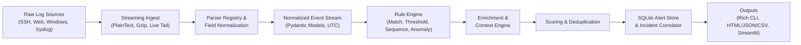

# SentinelLog 🛡️

A lightweight, defensive, Python-based log analysis and threat detection engine that mimics the daily workflow of a Security Operations Center (SOC) analyst.

```
       _   _             _   _                 
  ___  ___ _ __ | |_(_)_ __   ___| | | |    ___   __ _ 
 / __|/ _ \ '_ \| __| | '_ \ / _ \ | | |   / _ \ / _` |
 \__ \  __/ | | | |_| | | | |  __/ | | |__| (_) | (_| |
 |___/\___|_| |_|\__|_|_| |_|\___|_| |_____\___/ \__, |
                                                  |___/ 
```

[](https://github.com/your-username/sentinellog/actions)
[](https://www.python.org/downloads/)
[](https://opensource.org/licenses/MIT)

---

## 📖 Overview

In modern cybersecurity operations, a Security Operations Center (SOC) defends organizations by ingesting millions of telemetry records daily. **SentinelLog** is an educational, production-structured detection engine designed to demonstrate how security analysts parse raw machine logs, detect malicious activity using YAML detection rules, correlate multi-stage attacks, and present actionable findings.

### Key Capabilities
* **Multi-Source Streaming Ingestion:** Parses Linux SSH (`auth.log`), Web server access logs (Apache/Nginx Combined Log Format), Windows Security event logs (`.evtx`, CSV, JSON), and Syslog (RFC 3164/5424) without loading whole files into RAM.
* **Declarative YAML Rule Engine:** Supports `match`, `threshold` (sliding time windows), `sequence` (stateful attacker chains), and statistical `anomaly` detection.
* **Context & Enrichment:** Evaluates local threat intelligence blocklists, asset criticality, and optional GeoIP location.
* **Alert Deduplication & Scoring:** Employs a composite 0–100 risk scoring algorithm and collapses repeated alerts to mitigate alert fatigue.
* **Rich Analyst Experience:** High-visibility CLI terminal tables, standalone self-contained HTML incident reports, and an interactive Streamlit dashboard.

---

## 🏛️ Architecture



---

## 🚀 Quick Start

### 1. Prerequisites
* Python 3.11 or higher
* Git

### 2. Installation

#### Windows (PowerShell)
```powershell
# Clone the repository
git clone https://github.com/your-username/sentinellog.git
cd sentinellog

# Create and activate virtual environment
python -m venv .venv
.\.venv\Scripts\Activate.ps1

# Install in editable mode with development dependencies
pip install -e ".[dev]"
```

#### Ubuntu Linux (Bash)
```bash
# Clone the repository
git clone https://github.com/your-username/sentinellog.git
cd sentinellog

# Create and activate virtual environment
python3 -m venv .venv
source .venv/bin/activate

# Install in editable mode with development dependencies
pip install -e ".[dev]"
```

### 3. Verify Installation
```bash
sentinellog --help
sentinellog doctor
```

---

## 🧪 Running Tests & Quality Checks

Run the automated test suite and linters locally:

```bash
# Run unit and integration tests with coverage
pytest

# Check code formatting and style
ruff check .
black --check .

# Static type checking
mypy src
```

---

## 🗺️ Project Roadmap
- [x] **Phase 0:** Project foundations, CI pipeline, development environment, and base CLI.
- [ ] **Phase 1:** Streaming ingestion, normalized event schema, SSH and Web parsers.
- [ ] **Phase 2:** Declarative YAML rule engine (match & sliding threshold) with starter rule pack.
- [ ] **Phase 3:** Windows Event log parsing (`.evtx`), Syslog, and stateful sequence rules.
- [ ] **Phase 4:** Threat intelligence enrichment, asset weighting, deduplication, and SQLite storage.
- [ ] **Phase 5:** Statistical anomaly detection, live file tailing, and HTML executive reports.
- [ ] **Phase 6:** Streamlit interactive dashboard, performance profiling, and interview portfolio package.

---

## 📄 License
This project is licensed under the terms of the [MIT License](LICENSE).
