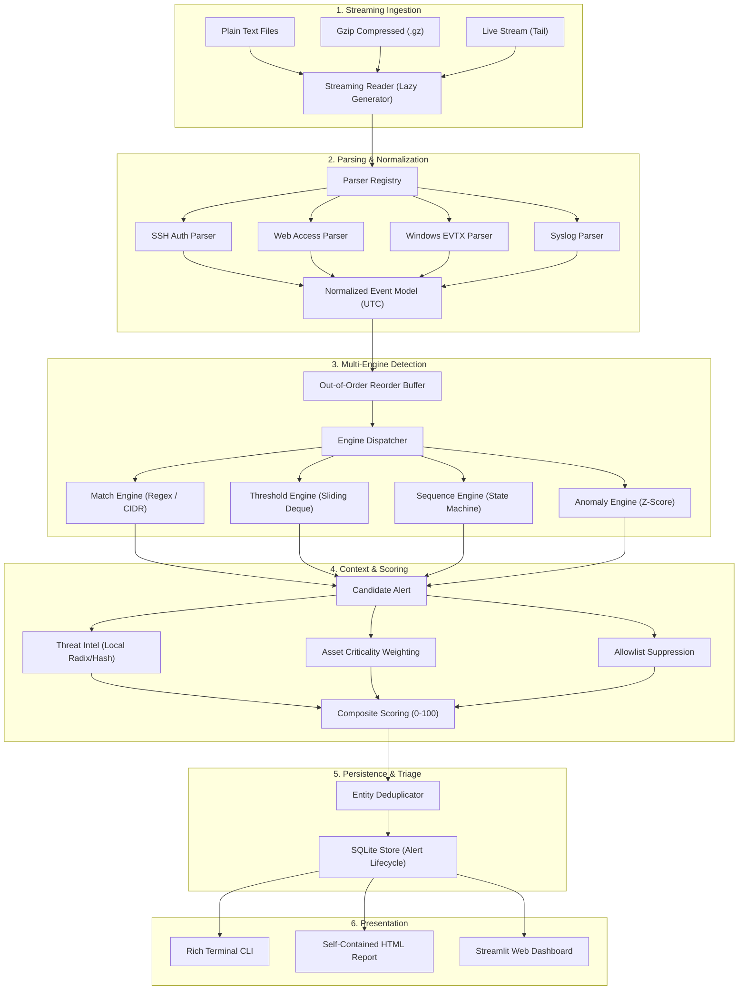

# SentinelLog System Architecture

## 1. High-Level Architecture Overview
SentinelLog is engineered around a pipeline architecture prioritizing low memory footprint, high throughput, and strict data provenance.

## 2. Key Design Decisions

### Streaming over In-Memory Buffering
Log files routinely range from several hundred megabytes to tens of gigabytes. Loading an entire log into a Python list consumes gigabytes of RAM. SentinelLog utilizes Python generator pipelines (`yield Event(...)`), reading line-by-line so memory usage stays flat regardless of input size.

### UTC Datetime Normalization
Logs from distributed systems come from varying time zones. All internal calculations, sliding windows, and event correlation normalize immediately to UTC.

### Pure Functions & Immutability
Core parsing and matching engines are stateless pure functions wherever possible, facilitating deterministic testing and avoiding race conditions.
